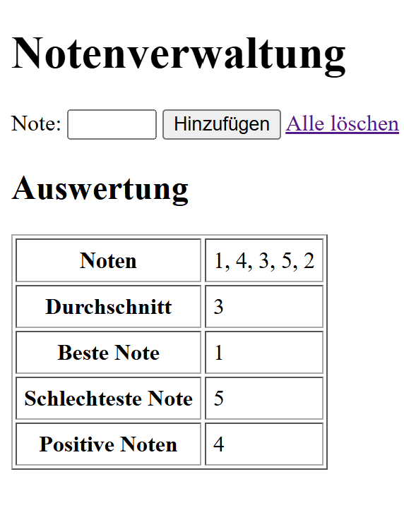
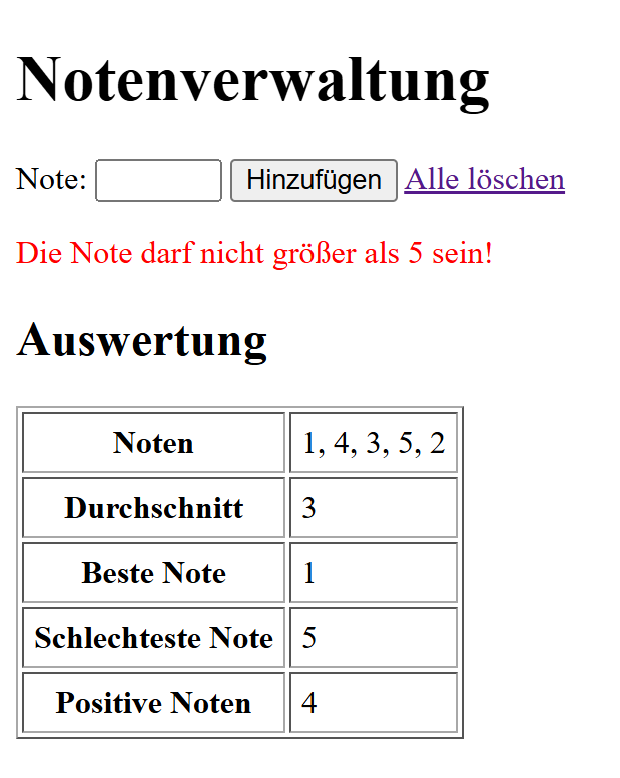
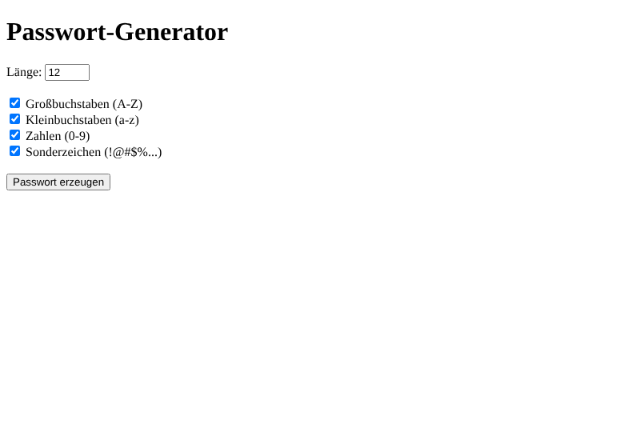
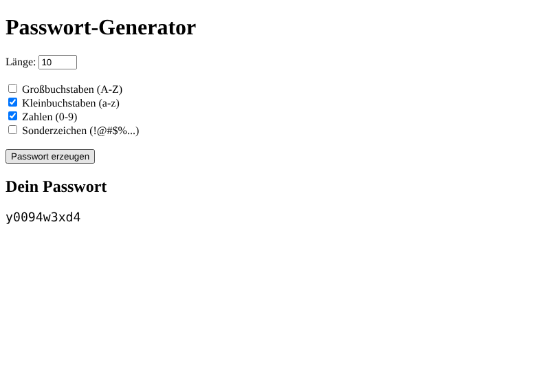
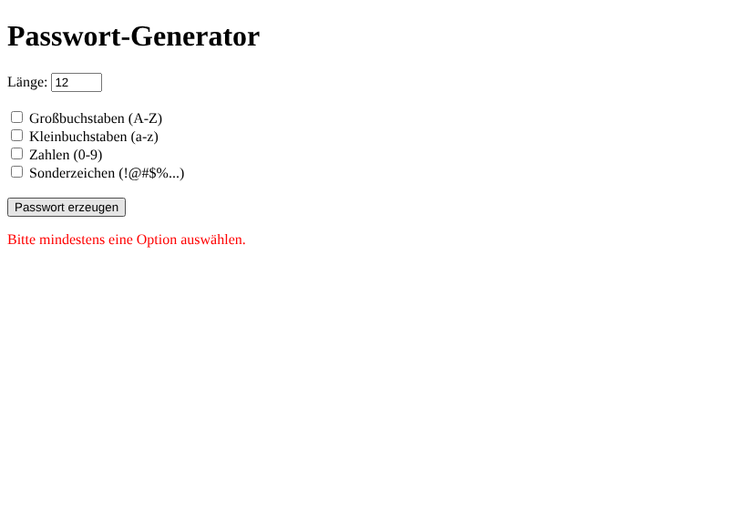

# Arbeitsbericht – PHP Grundlagen

* **Name:** Aldin Mukic & Anes Sejdic
* **Datum:** 12.10.2026
* **Fach:** ITSE Labor
* **Klasse:** 5AHITS
* **Aufgabe:** [PHP Übung](https://www.franzmatejka.at/htl/doc/ITSI_5/itsi5-lab/02_php.html)

---

## Inhaltsverzeichnis

- [Übung (PHP)](#übung-php)
  - [Aufgabenstellung](#aufgabenstellung)
  - [Cheat Sheet](#cheat-sheet)
- [1 Übung (Notenverwaltung)](#1-übung-notenverwaltung)
- [2 Übung (Passwort-Generator)](#2-übung-passwort-generator)
- [3 Übung (Zahlenratespiel)](#3-übung-zahlenratespiel)

---

## Übung (PHP)

### Aufgabenstellung

Wiederhole PHP Grundlagen, z.B. [w3schools](https://www.w3schools.com/php/)

Arbeitsbericht: Cheat Sheet der wichtigsten PHP Befehle und Konstrukte.

### Cheat Sheet

#### 1. Grundsyntax
- php code immer in `<?php ... ?>`
- datei muss `.php` heißen, läuft am **server** (z.b. xampp -> apache)
- jede anweisung endet mit `;`
- kommentare: `//` oder `#` (eine zeile), `/* ... */` (mehrere zeilen)
- php + html in der gleichen datei mischen geht
- html nur unter bedingung anzeigen: `<?php if ($x) { ?> <p>text</p> <?php } ?>`

Quelle: <https://www.w3schools.com/php/php_syntax.asp>

#### 2. Ausgabe
- `echo "hallo";` -> am häufigsten
- strings verbinden mit `.` -> `echo "Note: " . $note;`

Quelle: <https://www.w3schools.com/php/php_echo_print.asp>

#### 3. Variablen & Datentypen
- immer mit `$` -> `$name = "Aldin";`
- kein typ angeben nötig, php erkennt selber
- case sensitive: `$Note` nicht das selbe wie `$note`
- typen: string, int, float, bool, array, object, NULL
- casten: `(int)$x`, `(float)$x` -> string zu zahl (formular eingaben sind immer strings)
- konstanten: `define("MAX", 5);` oder `const MAX = 5;` -> ohne `$`

Quellen:  
<https://www.w3schools.com/php/php_variables.asp>  
<https://www.w3schools.com/php/php_datatypes.asp>  
<https://www.w3schools.com/php/php_constants.asp>  
<https://www.w3schools.com/php/php_casting.asp>

#### 4. Operatoren
- typischen die man eh schon kennt
- rechnen: `+ - * / % **` (`%` = rest, `**` = hoch)
- `==` -> nur wert gleich (`"5" == 5` -> true)
- `===` -> wert UND typ gleich (`"5" === 5` -> false)
- `!=` / `!==`, `< > <= >=`
- logisch: `&&`, `||`, `!`
- `$i++`, `$i--`
- `.=` -> string hinten anhängen: `$s .= "abc";`

Quelle: <https://www.w3schools.com/php/php_operators.asp>

#### 5. Bedingungen
```php
if ($note <= 4) {
    echo "positiv";
} elseif ($note == 5) {
    echo "negativ";
} else {
    echo "ungültig";
}
```
- der code erklärt es, man kennt es eh von C#

Quellen:  
<https://www.w3schools.com/php/php_if_else.asp>  
<https://www.w3schools.com/php/php_switch.asp>

#### 6. Schleifen
- `for ($i = 0; $i < 10; $i++) { }` 
- `while ($x < 10) { }` 
- `do { } while ();` -> läuft min. 1x
- `foreach ($array as $wert) { }` -> für arrays
- `foreach ($array as $key => $wert) { }` -> mit index/schlüssel
- `break` = schleife abbrechen

Quelle: <https://www.w3schools.com/php/php_looping.asp>

#### 7. Arrays
- indiziert: `$noten = [1, 3, 2];` -> `$noten[0]` = 1
- assoziativ: `$schueler = ["name" => "Aldin", "klasse" => "5AHITS"];`
- mehrdimensional: array in array
- hinten anhängen: `$noten[] = 4;`
- `count($a)` -> anzahl
- `array_sum($a)` -> summe 
- `max($a)` / `min($a)` -> größter / kleinster wert
- `sort()` aufsteigend, `rsort()` absteigend
- `in_array(3, $a)` -> ist wert drin?

Quellen:  
<https://www.w3schools.com/php/php_arrays.asp>  
<https://www.w3schools.com/php/php_ref_array.asp>

#### 8. Strings
- `strlen($s)` -> länge
- `strtoupper()` / `strtolower()`
- `str_replace("a", "b", $s)` -> ersetzen
- `substr($s, 0, 3)` -> teil rausschneiden
- `trim($s)` -> leerzeichen vorne/hinten weg
- `explode(",", $s)` -> string zu array
- `implode(", ", $a)` -> array zu string
- `str_contains($s, "x")` 
- `str_repeat("*", 5)` -> `*****`
- `$s[0]` -> einzelnes zeichen holen, index fängt bei 0 an

Quellen:  
<https://www.w3schools.com/php/php_string.asp>  
<https://www.w3schools.com/php/php_ref_string.asp>

#### 9. Funktionen
```php
function durchschnitt(array $noten): float {
    return array_sum($noten) / count($noten);
}
```
- `: float` -> rückgabetyp, funktion gibt immer eine kommazahl zurück
- variablen in funktion sind lokal also außen nicht sichtbar

Quelle: <https://www.w3schools.com/php/php_functions.asp>

#### 10. Mathe & Zufall
- `rand(1, 100)` -> zufallszahl
- `round($x, 2)` -> auf 2 kommastellen runden
- `number_format($x, 2, ",", ".")` -> zum schön formatieren

Quelle: <https://www.w3schools.com/php/php_math.asp>

#### 11. Formulare & Superglobals
- `$_GET` -> daten in der url
- `$_POST` -> daten im body (formular mit `method="post"`)
- `$_SERVER["REQUEST_METHOD"] == "POST"` -> prüfen ob abgeschickt
- `isset($x)` -> prüft ob existiert + nicht null
- `empty($x)` -> leer / 0 
- `is_numeric($x)` -> ist es eine zahl?
- `htmlspecialchars($x)` -> bei ausgabe von user vorteilshaft einzugeben (schutz vor XSS)
- `name="noten[]"` -> mehrere werte kommen als array an
- checkbox wird nur mitgeschickt wenn angehakt -> mit `isset()` prüfen
- `<input type="hidden">` -> unsichtbares feld, schickt werte trotzdem mit

Quellen:  
<https://www.w3schools.com/php/php_forms.asp>  
<https://www.w3schools.com/php/php_form_validation.asp>  
<https://www.w3schools.com/php/php_superglobals.asp>  
<https://www.w3schools.com/tags/att_input_type_hidden.asp>

#### 12. Sessions
- http ist zustandslos -> server vergisst alles nach jedem request
- `session_start();` -> ganz oben in der datei, vor jeder ausgabe
- `$_SESSION['zahl'] = 42;` -> bleibt über mehrere seitenaufrufe gespeichert
- `unset($_SESSION['zahl']);` -> einzelnen wert löschen
- `session_destroy();` -> ganze session weg

Quelle: <https://www.w3schools.com/php/php_sessions.asp>

#### 13. Formular (braucht man immer)

```php
<form method="post">
    <input type="number" name="zahl">
    <button type="submit">Senden</button>
</form>

<?php
if (isset($_POST["zahl"])) {
    if (is_numeric($_POST["zahl"])) {
        echo "Eingabe: " . $_POST["zahl"];
    } else {
        echo "Bitte eine Zahl eingeben";
    }
}
?>
```
- `method="post"` -> daten nicht in der url sichtbar
- kein `action` -> weil es schickt es automatisch an die gleiche datei zurück
- `name="zahl"` -> damit holt man es in php mit `$_POST["zahl"]`
- `isset($_POST["zahl"])` -> code läuft nur wenn formular abgeschickt wurde
- `is_numeric()` -> prüft ob wirklich eine zahl eingegeben wurde, sonst kommt eben das else

Quellen:  
<https://www.w3schools.com/php/php_forms.asp>  
<https://www.w3schools.com/php/php_form_validation.asp>

---

## 1 Übung (Notenverwaltung)

### Aufgabenstellung

- Mehrere Noten über ein Formular eingeben
- Noten in einem Array speichern
- Durchschnitt, beste/schlechteste Note und Anzahl der positiven Noten berechnen
- Ausgabe als HTML-Tabelle

### Lösung

Problem: http ist zustandslos -> nach jedem absenden wären die alten noten weg. Gelöst mit versteckten `hidden` feldern, die alle bisherigen noten wieder mitschicken.

```php
<?php
$noten = [];
$fehler = '';

// Bisherige Noten kommen ins Formular zurück
if (isset($_POST['noten'])) {
    foreach ($_POST['noten'] as $eingabe) {
        $noten[] = (float) $eingabe;
    }
}

// Neue Note prüfen und hinzufügen
if (isset($_POST['note']) && $_POST['note'] != '') {
    $neueNote = (float)$_POST['note'];

    if ($neueNote > 5) {
        $fehler = 'Die Note darf nicht größer als 5 sein!';
    } else {
        $noten[] = $neueNote;
    }
}
?>
<!DOCTYPE html>
<html lang="de">
<head>
    <meta charset="UTF-8">
    <title>Notenverwaltung</title>
</head>
<body>
    <h1>Notenverwaltung</h1>

    <form method="post">
        <?php foreach ($noten as $note) { ?>
            <input type="hidden" name="noten[]" value="<?php echo $note; ?>">
        <?php } ?>

        Note:
        <input type="text" name="note" size="4" autofocus>
        <button type="submit">Hinzufügen</button>
        <a href="notenverwaltung.php">Alle löschen</a>
    </form>

    <?php if ($fehler !== '') { ?>
        <p style="color: red;"><?php echo $fehler; ?></p>
    <?php } ?>

    <?php
    if (count($noten) > 0) {
        $durchschnitt = array_sum($noten) / count($noten);
        $beste = min($noten);
        $schlechteste = max($noten);
        $positive = 0;
        foreach ($noten as $note) {
            if ($note <= 4) {
                $positive++;
            }
        }
    ?>
        <h2>Auswertung</h2>
        <table border="1" cellpadding="5">
            <tr><th>Noten</th><td><?php echo implode(', ', $noten); ?></td></tr>
            <tr><th>Durchschnitt</th><td><?php echo round($durchschnitt, 2); ?></td></tr>
            <tr><th>Beste Note</th><td><?php echo $beste; ?></td></tr>
            <tr><th>Schlechteste Note</th><td><?php echo $schlechteste; ?></td></tr>
            <tr><th>Positive Noten</th><td><?php echo $positive; ?></td></tr>
        </table>
    <?php } ?>
</body>
</html>
```

- `name="noten[]"` -> alle hidden felder kommen als array in `$_POST['noten']` an
- `foreach` + `$noten[] = ...` -> alte noten wieder ins array
- `(float)` -> eingabe ist immer string, wird zu zahl umgewandelt
- note > 5 -> fehlermeldung, wird nicht gespeichert
- durchschnitt = `array_sum()` / `count()`
- beste note = `min()`, schlechteste = `max()` (weil 1 die beste ist)
- positive = alle noten `<= 4`, mit `foreach` + `$positive++` gezählt
- `implode()` -> noten mit beistrich als text ausgeben
- `round(..., 2)` -> durchschnitt auf 2 kommastellen
- "Alle löschen" -> link lädt seite ohne POST neu -> array ist leer
- verbesserung: 0 oder negative noten werden noch nicht abgefangen

**Ausgabe mit 5 Noten:**



**Fehler bei Note größer als 5:**



---

## 2 Übung (Passwort-Generator)

### Aufgabenstellung

- Länge über ein Formular festlegen
- Zufälliges Passwort erzeugen
- Optionen: Groß-/Kleinbuchstaben, Zahlen, Sonderzeichen

### Lösung

Idee: je nach angehakter checkbox wird ein "pool" an zeichen zusammengebaut, dann werden so oft zufällige zeichen daraus gezogen wie die länge ist.

```php
<?php
$passwort = '';
$fehler = '';
$laenge = 12;
$gesendet = isset($_POST['laenge']);

if ($gesendet) {
    $laenge = (int) $_POST['laenge'];

    // Zeichen-Pool je nach gewählten Optionen zusammenbauen
    $zeichen = '';
    if (isset($_POST['gross'])) {
        $zeichen .= 'ABCDEFGHIJKLMNOPQRSTUVWXYZ';
    }
    if (isset($_POST['klein'])) {
        $zeichen .= 'abcdefghijklmnopqrstuvwxyz';
    }
    if (isset($_POST['zahlen'])) {
        $zeichen .= '0123456789';
    }
    if (isset($_POST['sonder'])) {
        $zeichen .= '!@#$%&*?+-_=';
    }

    if ($laenge < 4 || $laenge > 64) {
        $fehler = 'Die Länge muss zwischen 4 und 64 liegen.';
    } elseif ($zeichen === '') {
        $fehler = 'Bitte mindestens eine Option auswählen.';
    } else {
        // Zufällige Zeichen aus dem Pool ziehen
        for ($i = 0; $i < $laenge; $i++) {
            $passwort .= $zeichen[random_int(0, strlen($zeichen) - 1)];
        }
    }
}
?>
<!DOCTYPE html>
<html lang="de">
<head>
    <meta charset="UTF-8">
    <title>Passwort-Generator</title>
</head>
<body>
    <h1>Passwort-Generator</h1>

    <form method="post">
        Länge:
        <input type="number" name="laenge" min="4" max="64" value="<?php echo $laenge; ?>">
        <br><br>

        <label>
            <input type="checkbox" name="gross" <?php if (!$gesendet || isset($_POST['gross'])) { echo 'checked'; } ?>>
            Großbuchstaben (A-Z)
        </label><br>
        <label>
            <input type="checkbox" name="klein" <?php if (!$gesendet || isset($_POST['klein'])) { echo 'checked'; } ?>>
            Kleinbuchstaben (a-z)
        </label><br>
        <label>
            <input type="checkbox" name="zahlen" <?php if (!$gesendet || isset($_POST['zahlen'])) { echo 'checked'; } ?>>
            Zahlen (0-9)
        </label><br>
        <label>
            <input type="checkbox" name="sonder" <?php if (!$gesendet || isset($_POST['sonder'])) { echo 'checked'; } ?>>
            Sonderzeichen (!@#$%...)
        </label><br><br>

        <button type="submit">Passwort erzeugen</button>
    </form>

    <?php if ($fehler !== '') { ?>
        <p style="color: red;"><?php echo $fehler; ?></p>
    <?php } ?>

    <?php if ($passwort !== '') { ?>
        <h2>Dein Passwort</h2>
        <p style="font-family: monospace; font-size: 1.4em;"><?php echo htmlspecialchars($passwort); ?></p>
    <?php } ?>
</body>
</html>
```

- `(int)` -> länge aus dem formular zu ganzzahl
- checkbox wird nur mitgeschickt wenn angehakt -> mit `isset()` prüfen
- `.=` -> zeichen an den pool dranhängen
- länge muss zwischen 4 und 64 sein, sonst fehler
- keine option angehakt -> `$zeichen` bleibt leer -> fehler
- `for` schleife läuft `$laenge` mal
- `random_int(0, strlen($zeichen) - 1)` -> zufälliger index im pool, `-1` weil index bei 0 anfängt
- `$zeichen[...]` -> einzelnes zeichen aus dem string holen
- `random_int` statt `rand` -> kryptografisch sicher, wichtig bei passwörtern
- `!$gesendet || isset(...)` -> beim ersten aufruf alles angehakt, danach bleibt die auswahl gleich
- `htmlspecialchars()` bei der ausgabe -> wegen sonderzeichen wie `<` `>` `&`

**Formular beim ersten Aufruf (alles angehakt):**



**Nur Kleinbuchstaben + Zahlen, Länge 10:**



**Keine Option ausgewählt:**



---

## 3 Übung (Zahlenratespiel)

### Aufgabenstellung

- Server erzeugt eine Zufallszahl
- Benutzer gibt einen Tipp ab
- PHP antwortet mit „zu hoch“, „zu niedrig“ oder „richtig“
- Anzahl der Versuche mitzählen

### Lösung

Haben wir zeitlich in der Stunde leider nicht mehr geschafft.
